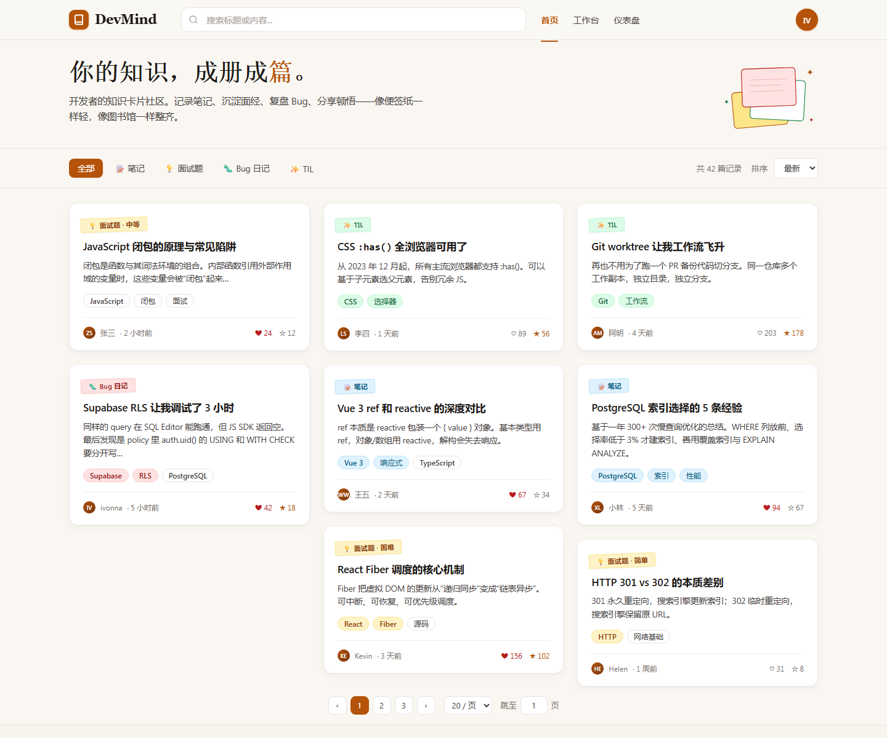
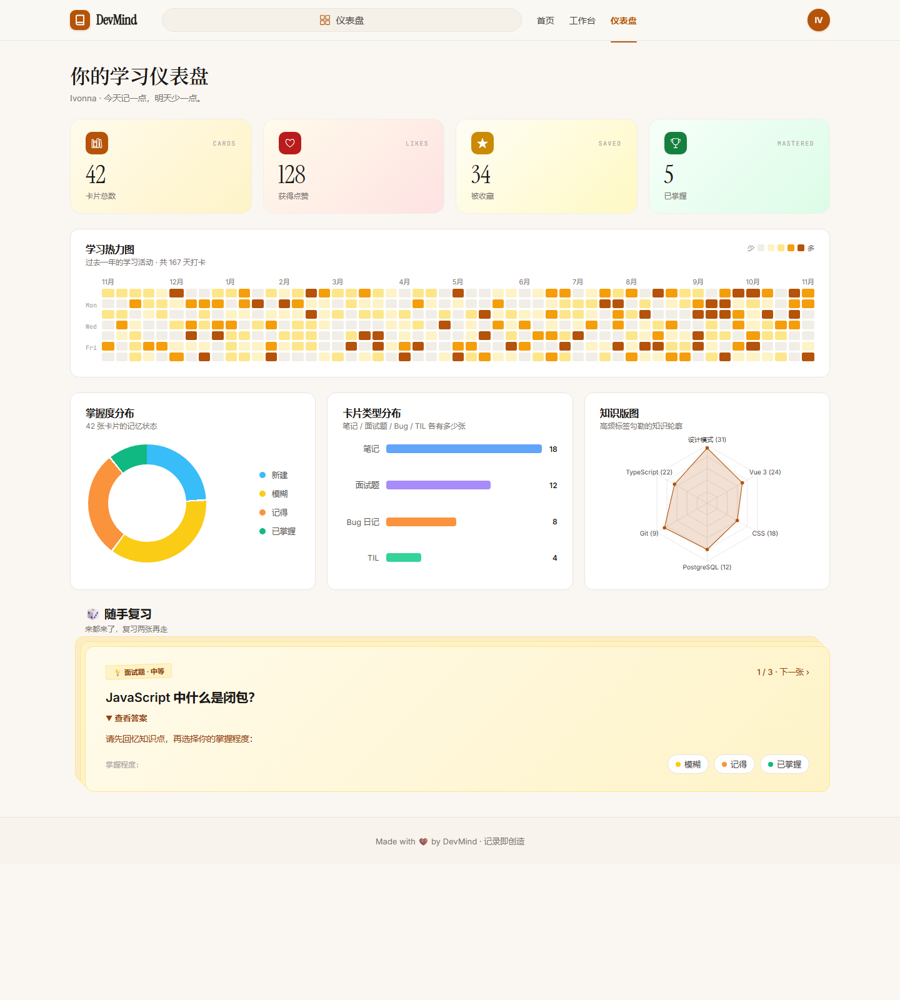

# DevMind

DevMind 是一个面向开发者的知识卡片应用，用来记录技术笔记、面试题、Bug 复盘和 TIL，并通过标签、复习和统计帮助持续整理知识。

[](https://vuejs.org/)
[](https://www.typescriptlang.org/)
[](https://expressjs.com/)
[](https://supabase.com/)
[](https://vite.dev/)

> **在线体验：**目前没有适合公开使用的 HTTPS Demo。项目已在腾讯云完成基础部署和连通性测试，但当前公网测试仍为 HTTP；配置域名和 HTTPS 前，请勿在该地址输入真实密码或敏感信息。

## 界面预览

以下图片来自 `docs/mockups/` 中的静态 HTML 设计稿。

### 首页设计稿



### 仪表盘设计稿



更多页面设计稿可查看 [`docs/mockups/`](docs/mockups/)。

## 功能

- 注册、登录及公开个人主页
- 创建和管理笔记、面试题、Bug 日志及 TIL 卡片
- Markdown 内容、标签、置顶，以及公开/私有可见性
- 浏览公开卡片、查看详情、点赞和收藏
- 随机复习卡片并记录掌握情况
- 学习仪表盘：卡片统计、复习掌握度、标签和学习热力图

## 技术栈

| 部分 | 技术 |
| --- | --- |
| 前端 | Vue 3、TypeScript、Vite、Vue Router、Pinia、Naive UI、Tailwind CSS、ECharts |
| 后端 | Node.js、Express 5、TypeScript、Zod、JWT、bcrypt |
| 数据库 | Supabase PostgreSQL |
| 部署 | 腾讯云 Ubuntu、Nginx、systemd |

## 项目结构

```text
client/       Vue 3 前端
server/       Express API 后端
docs/         项目文档、设计稿和数据库结构参考
```

## 本地运行

### 环境要求

- Node.js 22.x
- npm
- 一个可连接的 Supabase PostgreSQL 项目

前后端分别管理依赖，因此需要在各自目录安装。

### 1. 获取代码并安装依赖

```bash
git clone https://github.com/Ivonna-7/devmind.git
cd devmind

cd server
npm ci
cd ../client
npm ci
cd ..
```

### 2. 配置后端环境变量

复制示例文件：

```bash
cp server/.env.example server/.env
```

在 `server/.env` 中填写自己的配置：

```env
DATABASE_URL=你的Supabase_PostgreSQL连接串
PORT=3000
JWT_SECRET=你生成的高强度随机密钥
CLIENT_URL=http://localhost:5173
```

不要把真实 `.env`、数据库密码或 JWT 密钥提交到 Git。仓库中的 `.gitignore` 已忽略 `.env` 文件。

### 3. 分别启动后端和前端

在一个终端启动后端：

```bash
cd server
npm run dev
```

在另一个终端启动前端：

```bash
cd client
npm run dev
```

打开 Vite 输出的本地地址（通常为 `http://localhost:5173`）。本地开发时，Vite 会将 `/api` 请求代理到 `http://localhost:3000`。

## 构建

构建前端：

```bash
cd client
npm run build
```

编译后端：

```bash
cd server
npm run backend:build
```

## 数据库结构参考

从 Supabase 导出的 `public` schema 结构资料位于 [`docs/Supabase/`](docs/Supabase/)：

- [`schema.sql`](docs/Supabase/schema.sql)：Schema Visualizer 复制的结构 SQL，仅供查看参考，不保证可以直接执行或完整重建数据库。
- [`schema-columns.csv`](docs/Supabase/schema-columns.csv)：表字段、类型、长度及可空性清单。
- [`database-schema.png`](docs/Supabase/database-schema.png)：表关系图。

以上文件不包含业务表数据。数据库结构发生变化后，需要重新导出并更新这些参考资料。

## 部署状态

- 后端已部署到腾讯云 Ubuntu，通过 systemd 在后台运行，并连接 Supabase 数据库。
- 前端已构建并由 Nginx 提供；Nginx 将 `/api` 请求转发给同机后端。
- 已验证服务器本机 API 响应及公网 HTTP 页面访问。

## 当前限制

- 线上端到端业务流程仍需在配置 HTTPS 后完成验收。
